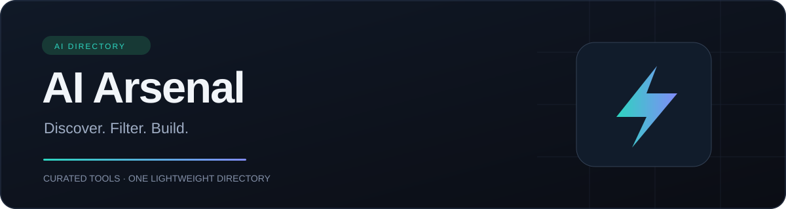

<p align="center">
  
</p>

<p align="center">
  <a href="https://nauman-rajput.github.io/AI-Directory/">Explore the directory</a> ·
  <a href="#getting-started">Run locally</a> ·
  <a href="CONTRIBUTING.md">Contribute</a> ·
  <a href="https://github.com/Nauman-rajput/AI-Directory/issues/new/choose">Suggest a tool</a>
</p>

<p align="center">
  <a href="https://github.com/Nauman-rajput/AI-Directory/actions/workflows/deploy-pages.yml"></a>
  <a href="LICENSE"></a>
  
  
  
</p>

# AI Arsenal

A searchable directory of **255 tools** across **14 categories**, built for discovering AI assistants, creative tools, developer platforms and research resources.

Search by name, domain or category; narrow the collection by pricing; and keep your favorite tools close. The application runs from one HTML file, with no build step, account or backend required.

## Features

| Feature | What you can do |
| --- | --- |
| Search and filters | Search instantly and combine category and Free, Freemium or Paid filters. |
| Sorting | Browse A → Z, Z → A, or starred tools first. |
| Saved favorites | Star tools and retain your choices in the same browser. |
| Responsive interface | Use the directory on mobile, tablet and desktop. |
| Keyboard access | Skip to content, use labeled controls and close the mobile menu with Escape. |
| Lightweight delivery | Load icons lazily; use a letter fallback if icon sources fail. |
| Share previews | Page description and social metadata identify the directory when shared. |
| Automated validation | Check entry format, categories, pricing tiers, duplicate URLs and JavaScript syntax before deployment. |

## Categories

| Discover | Create | Build and work |
| --- | --- | --- |
| Chatbots & Assistants | Image Generation | Coding & Development |
| Platforms & Hubs | Video Generation | Automation & Workflow |
| Directories & Learning | Audio, Voice & Music | Writing & Productivity |
| Miscellaneous | Design & UI/UX | Image Editing |
| | Branding & Logos | Video Editing |

## Getting started

Use the [live directory](https://nauman-rajput.github.io/AI-Directory/) or download `index.html` and open it in a modern browser.

To work with the repository:

```bash
git clone https://github.com/Nauman-rajput/AI-Directory.git
cd AI-Directory
```

Open `index.html`, or serve it locally for a consistent browser origin:

```bash
python -m http.server 8000
```

Then visit `http://localhost:8000`. Python is optional; it is only needed for this local-server command. External fonts, icons and linked services require internet access.

## Adding a tool

Entries live in the `RAW` array inside `index.html`:

```js
["Tool name", "https://official.example/", "CH WP", "freemium"],
```

The fields are **name**, **official URL**, **category codes** and **pricing tier**. The first category is the primary category; additional codes make the tool discoverable in other categories.

- **Free:** the listed tool is available without a paid plan.
- **Freemium:** limited free usage or credits are available, with paid upgrades.
- **Paid:** a paid plan is required; a temporary trial alone does not make a tool free.

Prefer official product pages, verify pricing, and avoid duplicate URLs or unsupported promotional claims. See [CONTRIBUTING.md](CONTRIBUTING.md) for the complete process.

## Validation and deployment

Run the dependency-free validator with Node.js:

```bash
node scripts/validate-directory.cjs
```

Also check search, filters, favorites and mobile navigation in a browser. The validator checks data and syntax; it does not confirm that external websites are reachable or that their prices remain current.

GitHub Actions validates pushes to `main` and pull requests. Successful pushes to `main` publish the HTML application to GitHub Pages. Pull requests run validation without deploying.

## Project structure

```text
AI-Directory/
├── index.html                  # Standalone directory and tool data
├── assets/banner.svg           # Repository banner
├── scripts/validate-directory.cjs
├── .github/                    # Workflow and contribution templates
├── README.md
├── CONTRIBUTING.md
├── SECURITY.md
└── LICENSE
```

## Privacy and curation

Favorites are stored in your browser's local storage; they do not sync between devices. Clearing browser data removes them. Google Fonts and third-party favicon services receive requests when the page loads; visiting a tool follows that service's own policies.

Pricing, availability and regional access can change. Confirm current terms on each official website. Inclusion is a discovery reference, not an endorsement or a guarantee of accuracy.

## Maintainer and license

Created and maintained by **Muhammad Nauman Rajput** · [GitHub](https://github.com/Nauman-rajput) · [LinkedIn](https://www.linkedin.com/in/muhammad-nauman-800b50433/)

Released under the [MIT License](LICENSE). For vulnerability reporting, see [SECURITY.md](SECURITY.md).
